<p align="center">
  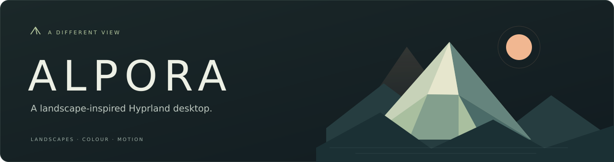
</p>

<p align="center">
  <a href="#рабочий-стол">Рабочий стол</a> &nbsp; / &nbsp;
  <a href="#пейзажи">Пейзажи</a> &nbsp; / &nbsp;
  <a href="#установка">Установка</a> &nbsp; / &nbsp;
  <a href="README.md">Документация</a> &nbsp; / &nbsp;
  <a href="../README.md">English</a>
</p>

<p align="center">
  
  
  <a href="LICENSE"></a>
</p>

<p align="center"><b>Горы на рассвете. Озеро после заката. Рабочий стол в цветах пейзажа.</b></p>

**ALPORA — Альпора** объединяет Hyprland, гранёные пейзажи, полупрозрачные панели
и согласованные цвета в окружении для Arch Linux. Маленький робот добавляет ему
характер. Интерфейс написан на QML с Quickshell, системная часть — на Python.

<a id="рабочий-стол"></a>
## 01 &nbsp; Место для твоих идей

[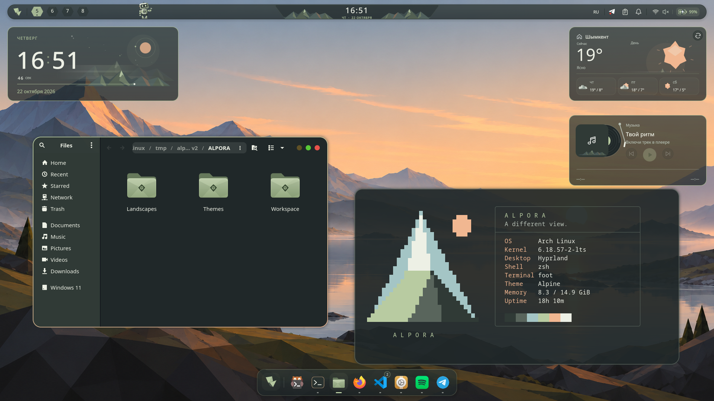](media/showcase-alpine.png)

<p align="center"><sub>АЛЬПИЙСКИЙ РАССВЕТ &nbsp; · &nbsp; Nautilus + ALPORA Fetch в Foot &nbsp; · &nbsp; Papirus + Bibata &nbsp; · &nbsp; 1920 × 1080</sub></p>

Горная панель над окнами. Док, который появляется у края экрана. Часы, погода
и музыка на рабочем столе. Приложения и обзор рабочих столов под рукой,
а отдельное окно настроек позволяет подогнать детали под себя.

<a id="пейзажи"></a>
## 02 &nbsp; Шесть пейзажей. Одно окружение.

Выбираешь пейзаж — его палитру получают панель, виджеты, папки, рамки окон
и поддерживаемые приложения. Режимы Work/Vibe остаются независимыми от темы.

[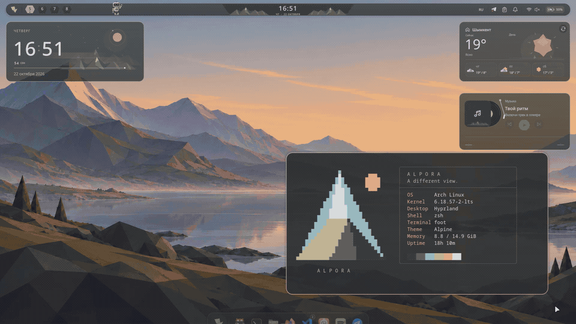](media/theme-switching.mp4)

<p align="center"><sub>ЗАПИСЬ ЭКРАНА &nbsp; · &nbsp; Новый пейзаж и цвета открытой карточки системы &nbsp; · &nbsp; <a href="media/theme-switching.mp4">Открыть видео</a></sub></p>

<table>
  <tr>
    <td width="50%"><a href="media/palette-alpine.png">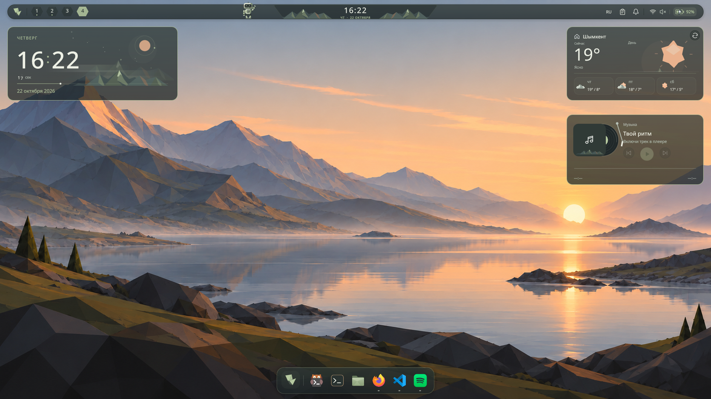</a><br><b>01 / Альпийский рассвет</b><br><sub>Шалфейные акценты, тёплый свет и спокойная вода.</sub></td>
    <td width="50%"><a href="media/palette-moon-lake.png">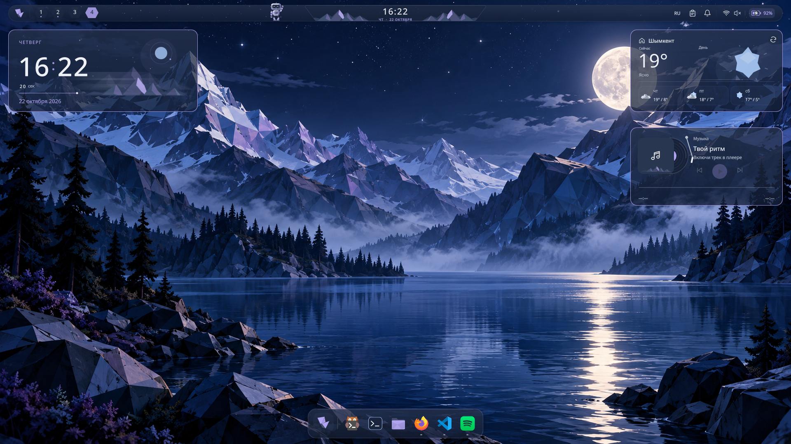</a><br><b>02 / Лунное озеро</b><br><sub>Глубокий синий с оттенками лаванды.</sub></td>
  </tr>
  <tr>
    <td><a href="media/palette-forest-mist.png">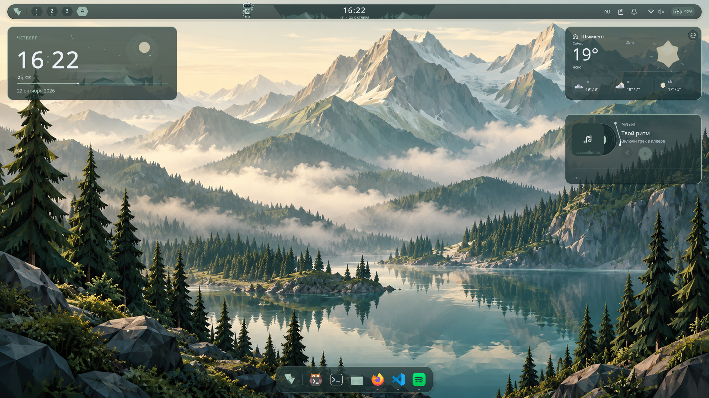</a><br><b>03 / Лесной туман</b><br><sub>Зелёные склоны и растворяющиеся вдали хребты.</sub></td>
    <td><a href="media/palette-warm-desert.png">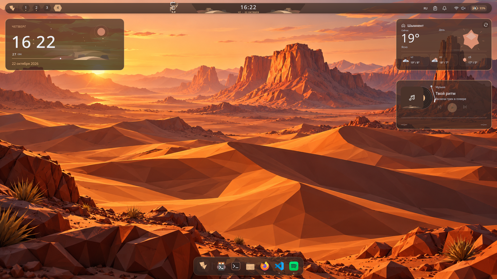</a><br><b>04 / Тёплая пустыня</b><br><sub>Охристые дюны и прогретые солнцем поверхности.</sub></td>
  </tr>
  <tr>
    <td><a href="media/palette-northern-lights.png">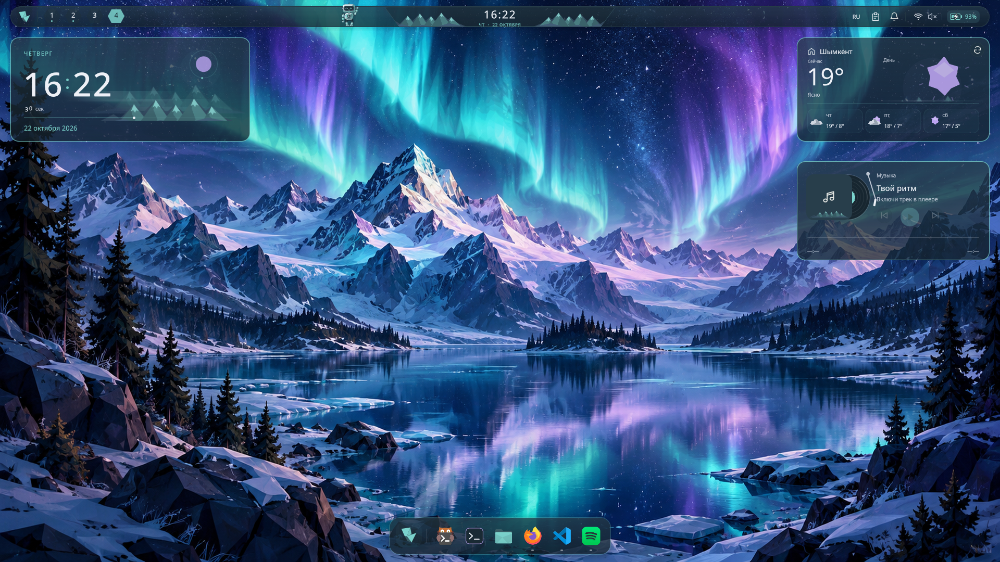</a><br><b>05 / Северное сияние</b><br><sub>Ледяные вершины под бирюзовым небом.</sub></td>
    <td><a href="media/palette-rose-sunset.png">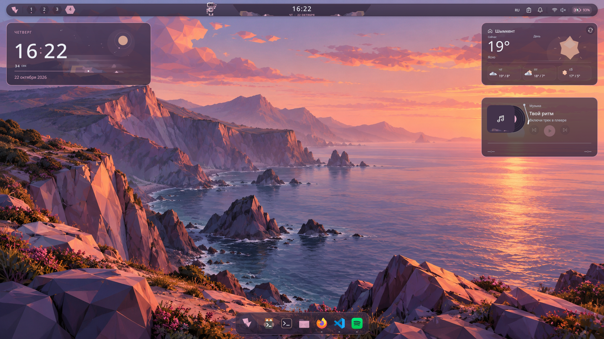</a><br><b>06 / Розовый закат</b><br><sub>Пыльная роза, прибрежные скалы и вечерний свет.</sub></td>
  </tr>
</table>

**Седьмой вариант — Timeline:** пейзажи для разного времени суток.
Можно импортировать свои обои и получить палитру из изображения.
[Подробнее о темах →](features/wallpaper-themes.md)

## 03 &nbsp; Детали складываются в целое

<table>
  <tr>
    <td width="50%"><a href="media/theme-orbit.png">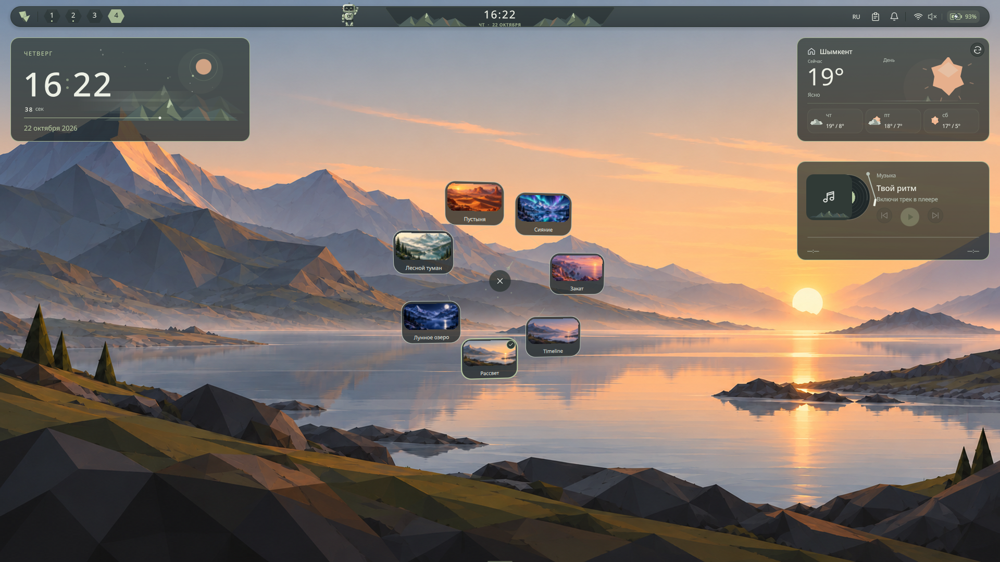</a><br><b>Маленькая орбита пейзажей.</b><br><sub>Настоящий переключатель тем прямо на рабочем столе.</sub></td>
    <td width="50%"><a href="media/settings-appearance.png">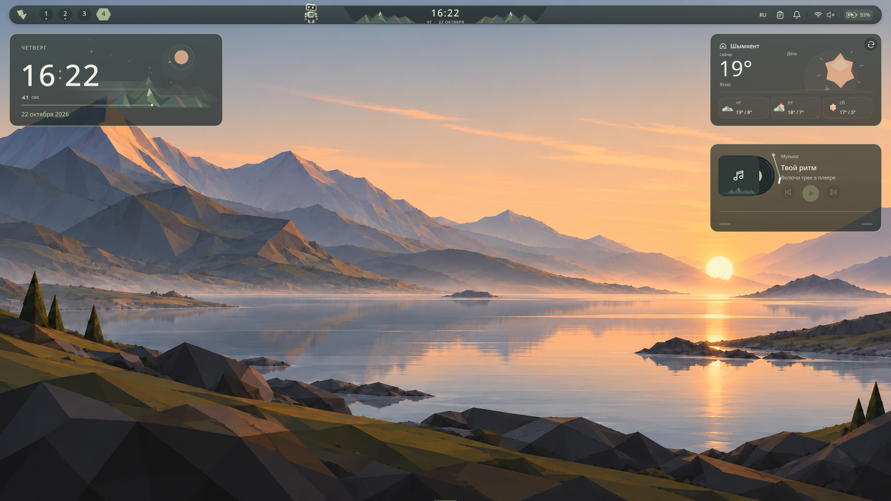</a><br><b>Оформление под тебя.</b><br><sub>Прозрачность, скругления, отступы и анимации с сохранением черновика.</sub></td>
  </tr>
</table>

| Возможность | Что внутри |
| :--- | :--- |
| **Окна и приложения** | Обзор рабочих столов, поиск, общее избранное и док у нижнего края экрана. |
| **Планы на день** | Календарь, локальные задачи, заметки и таймер фокуса без отдельного аккаунта. |
| **Управление системой** | Звук, подключение и доступное оборудование, уведомления и история буфера обмена. |
| **Твоя музыка** | Виджеты и управление настоящими MPRIS-плеерами. |
| **Робот Грань** | Ходит, летает, садится на доступные края окон и виджетов. Его можно поймать и перетащить. Видимость и полёты отключаются. |
| **Общий стиль** | Papirus, папки в цветах тем, курсор Bibata Modern Ice и редактор горячих клавиш Lua. |
| **ALPORA Fetch** | Горный логотип и реальные данные системы в терминале. Открытая карточка меняет цвета вместе с окружением. [Лунная тема](media/showcase-moon.png). |

Поддерживается уменьшение анимаций. Виджеты и робот отключаются в настройках.
Интерактивные точки на обоях по умолчанию выключены. Основной язык интерфейса — русский.

<a id="установка"></a>
## 04 &nbsp; От терминала к своему пейзажу

**Arch Linux · обычный пользователь · работающий интернет · доступ к sudo.**
Скачай или клонируй репозиторий в постоянный каталог и открой в нём терминал.
Установщик создаёт ссылки на этот каталог — после установки его нужно сохранить.

```sh
git clone https://github.com/IhTiYaR0/alpora.git
cd alpora

./install.sh --preview          # Живая карточка системы без установки; выход q
./install.sh --dry-run --wizard  # Посмотреть мастер и полный план без изменений
./install.sh                    # Установить ALPORA и выбрать первую тему
```

Карточка системы в стиле neofetch с горным логотипом ALPORA и текущей палитрой:
`./bin/alpora-fetch`. Работает без установки, выводит реальные данные системы
и в открытом терминале автоматически обновляет цвета при смене темы, включая
Timeline. Выход — `q`, Escape или `Ctrl+C`. Для обычного разового вывода:
`./bin/alpora-fetch --once`. Для просмотра фиксированной темы:
`./bin/alpora-fetch --theme=moon-lake`. Фоновые службы не создаются.

Мастер устанавливает пакеты, скачивает проверенные иконки и курсор, сохраняет
резервные копии, применяет фирменный пресет и настраивает автозапуск. Этапы и время
показывают настоящую работу. Pacman и sudo сохраняют обычные запросы; перед
заменой личной конфигурации Hyprland установщик спросит согласие.

После установки выйди из сеанса и выбери **Hyprland** либо запусти его из TTY.
Драйвер видеокарты, загрузчик и менеджер входа установщик не меняет.

В новом сеансе можно открыть настройки и ту же карточку, что на скриншоте:

```sh
~/.local/bin/poly-shell status
~/.local/bin/poly-shell settings
~/.local/bin/alpora-fetch
```

Если `~/.local/bin` есть в `PATH`, достаточно команд `poly-shell` и `alpora-fetch`.
Карточка открывается по запросу. Примеры папок и расположение окон Nautilus/Foot
на фото — демонстрационная композиция; личные файлы и показатели системы будут твоими.
[Карточка системы](features/system-card.md) · [Файлы и каталоги установки](architecture/repository-layout.md)

| Что нужно | Команда или инструкция |
| :--- | :--- |
| Сразу выбрать тему | `./install.sh --theme=northern-lights` |
| Установить только интерфейс (UI-only) | `./install.sh --ui-only` |
| Установить только ядро без сторонних программ | `./install.sh --core-only` |
| Посмотреть полный план | `./install.sh --dry-run` |
| Полное удаление ALPORA | `./uninstall.sh` (или `./uninstall.sh --restore-config`) |
| Узнать про копии и восстановление | [Инструкция установщика](guides/arch-installer.md) |
| Добавить только компоненты окружения | [Отдельная установка](guides/installation.md) |
| Узнать все программы и зависимости | [Список инструментов](guides/programs.md) |

<details>
<summary><b>Совместимость и ограничения предварительной версии</b></summary>

Локально проверенная основа: Arch Linux, Hyprland **0.56.2**, Quickshell **0.3.2**,
Qt **6.12.0**. Установщик поддерживает Arch Linux и производные дистрибутивы
(EndeavourOS, CachyOS, Manjaro, Garuda, Artix, ArcoLinux, Archcraft), а также
пользовательские ядра. Для сохранения собственной конфигурации Hyprland или запуска
на других системах доступен режим `--ui-only`. Скрипт `./uninstall.sh` обеспечивает
чистое удаление символических ссылок, служб systemd и восстановление резервных копий.
Полная установка и первый вход на чистой Arch ещё предстоят.
Эталонная композиция рассчитана на 1920×1080 при масштабе 1. Другие экраны
используют существующую адаптацию и требуют дополнительной проверки.

Существующие предпочтения сохраняются. Новый аккаунт получает фирменный пресет,
а не личные заметки, буфер обмена, аккаунты или город автора. Показания устройств,
погода, список приложений и оформление внутри сторонних программ могут отличаться.

Виджеты рабочего стола и робот оптимизированы по нагрузке на CPU в покое.
Оболочка поддерживает английский (базовый), вьетнамский и русский языки через встроенный
фреймворк i18n. Сон, подключение мониторов и дополнительные сочетания устройств требуют проверки.
Новые Bluetooth-устройства сопрягаются через терминал; редактор расположения мониторов пока не реализован.

Последняя локальная проверка: **197 тестов и строгий QML lint**. Это локальные
результаты, а не значок работающего CI.
[Известные ограничения](guides/known-issues.md) · [Проверка для нового пользователя](audits/install-validation-2026-10-22.md) · [Аудит кода](audits/code-audit-2026-10-22.md).

</details>

## 05 &nbsp; Быстро освоиться

| Сочетание | Действие |
| :--- | :--- |
| <kbd>Super</kbd> + <kbd>Return</kbd> | Терминал |
| <kbd>Super</kbd> + <kbd>E</kbd> | Файловый менеджер |
| <kbd>Super</kbd> + <kbd>R</kbd> | Приложения |
| <kbd>Super</kbd> + <kbd>I</kbd> | Быстрые настройки |
| <kbd>Super</kbd> + <kbd>Tab</kbd> | Обзор рабочих столов |
| <kbd>Super</kbd> + <kbd>Shift</kbd> + <kbd>V</kbd> | Плавающее окно и обратно |
| <kbd>Super</kbd> + перетаскивание ЛКМ / ПКМ | Перемещение / размер окна |

Это сочетания из поставляемой конфигурации. Поддерживаемые назначения можно
изменить в «Настройки → Горячие клавиши». Техническое имя команды и каталогов
остаётся `poly-shell`, чтобы сохранить совместимость.

[Документация](README.md) &nbsp; / &nbsp; [Горячие клавиши](guides/shortcuts.md) &nbsp; / &nbsp;
[Темы](features/wallpaper-themes.md) &nbsp; / &nbsp; [Робот](features/desktop-companion.md) &nbsp; / &nbsp;
[Участие](../.github/CONTRIBUTING.md) &nbsp; / &nbsp; [Изменения](CHANGELOG.md)

---

<p align="center"><b>ALPORA</b> &nbsp; — &nbsp; Другой взгляд на рабочий стол.</p>
<p align="center"><sub>Автор: IhTiYaR0 · Hyprland, Quickshell, Qt и Python</sub></p>

Авторский код и векторы — [MIT](LICENSE). Papirus, Bibata и исторические материалы
Adwaita сохраняют свои лицензии. Пейзажи созданы с помощью генерации изображений
OpenAI. [Благодарности и лицензии](../licenses/THIRD_PARTY_NOTICES.md) ·
[Происхождение снимков и референсы оформления](media/README.md).
