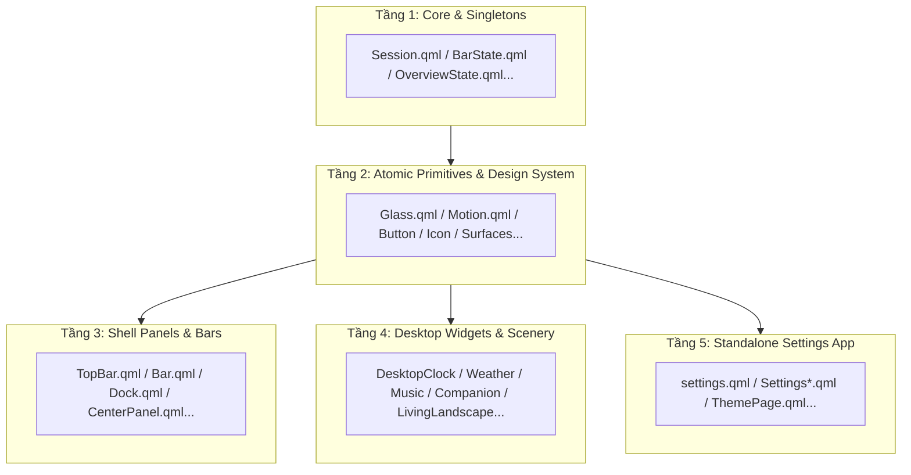

# ALPORA Component Taxonomy & Architecture Map

## 1. Giới thiệu (Overview)
Giao diện người dùng của **ALPORA** được xây dựng trên nền tảng **Quickshell (Qt 6 / QML)** với 151 files trong thư mục [`shell/`](file:///d:/code/alpora/shell). Tài liệu này đóng vai trò là **Bản đồ Kiến trúc Phân tầng (Architecture Map)** chính thức, phân loại chi tiết các thành phần theo trách nhiệm để định hướng cho việc mở rộng tính năng và duy trì an toàn hệ thống.

---

## 2. Phân loại 151 Thành phần trong `shell/`

### Nhóm A: Core & Trạng thái Hệ thống (Singletons & State)
Các đối tượng toàn cục chia sẻ dữ liệu giữa các panel, widget và kết nối với D-Bus / Quickshell Services:
* [`Session.qml`](file:///d:/code/alpora/shell/Session.qml): Trung tâm điều phối phiên, phần cứng (battery, brightness, audio, wifi, bluetooth).
* [`BarState.qml`](file:///d:/code/alpora/shell/BarState.qml): Quản lý popup, hover timer và lựa chọn màn hình trên bar.
* [`OverviewState.qml`](file:///d:/code/alpora/shell/OverviewState.qml): Trạng thái vuốt cử chỉ và bố cục tổng quan workspace.
* [`DockState.qml`](file:///d:/code/alpora/shell/DockState.qml), [`ClockState.qml`](file:///d:/code/alpora/shell/ClockState.qml), [`DayState.qml`](file:///d:/code/alpora/shell/DayState.qml): Trạng thái mở dock, đồng hồ, lịch.
* [`MusicState.qml`](file:///d:/code/alpora/shell/MusicState.qml): Trạng thái MPRIS media player.
* [`ThemeState.qml`](file:///d:/code/alpora/shell/ThemeState.qml), [`TimelineState.qml`](file:///d:/code/alpora/shell/TimelineState.qml), [`LandscapeState.qml`](file:///d:/code/alpora/shell/LandscapeState.qml): Quản lý chủ đề màu và timeline theo cảnh quan.
* [`WindowTracker.qml`](file:///d:/code/alpora/shell/WindowTracker.qml), [`RunningAppsState.qml`](file:///d:/code/alpora/shell/RunningAppsState.qml): Theo dõi cửa sổ đang mở qua IPC Hyprland.
* [`AudioFeedback.qml`](file:///d:/code/alpora/shell/AudioFeedback.qml), [`I18n.qml`](file:///d:/code/alpora/shell/I18n.qml): Âm thanh phản hồi và đa ngôn ngữ.

### Nhóm B: Shell Panels & Bars (Khung Điều khiển Chính)
* [`TopBar.qml`](file:///d:/code/alpora/shell/TopBar.qml) / [`Bar.qml`](file:///d:/code/alpora/shell/Bar.qml): Thanh panel chính trên cùng màn hình.
* [`Dock.qml`](file:///d:/code/alpora/shell/Dock.qml): Thanh dock dưới đáy màn hình hiển thị ứng dụng đang chạy và ghim.
* [`CenterPanel.qml`](file:///d:/code/alpora/shell/CenterPanel.qml): Khung trung tâm tích hợp lịch, thời tiết và phím tắt.
* [`QuickSettings.qml`](file:///d:/code/alpora/shell/QuickSettings.qml) & [`QuickHoverContent.qml`](file:///d:/code/alpora/shell/QuickHoverContent.qml): Bảng điều khiển cài đặt nhanh và hover popup.
* [`PowerMenu.qml`](file:///d:/code/alpora/shell/PowerMenu.qml): Menu nguồn (tắt máy, khởi động lại, khóa màn hình).
* [`DisplayProjectMenu.qml`](file:///d:/code/alpora/shell/DisplayProjectMenu.qml): Menu chuyển đổi chế độ chiếu đa màn hình.
* [`NotificationsPanel.qml`](file:///d:/code/alpora/shell/NotificationsPanel.qml) / [`Osd.qml`](file:///d:/code/alpora/shell/Osd.qml): Trung tâm thông báo và hiển thị OSD âm lượng/độ sáng.

### Nhóm C: Desktop Widgets & Scenery (Tiện ích Màn hình Chính)
* [`DesktopWidgets.qml`](file:///d:/code/alpora/shell/DesktopWidgets.qml): Bộ điều phối vị trí các widget trên màn hình.
* [`DesktopClock.qml`](file:///d:/code/alpora/shell/DesktopClock.qml), [`DesktopWeather.qml`](file:///d:/code/alpora/shell/DesktopWeather.qml), [`DesktopMusic.qml`](file:///d:/code/alpora/shell/DesktopMusic.qml): Widget đồng hồ số/kim, thời tiết và trình phát nhạc.
* [`DesktopCompanion.qml`](file:///d:/code/alpora/shell/DesktopCompanion.qml) / [`CompanionSprite.qml`](file:///d:/code/alpora/shell/CompanionSprite.qml): Robot đồng hành ALPORA bay và tương tác vật lý.
* [`LivingLandscape.qml`](file:///d:/code/alpora/shell/LivingLandscape.qml) / [`ClockLandscape.qml`](file:///d:/code/alpora/shell/ClockLandscape.qml): Đồ họa phong cảnh 6 chủ đề chuyển động theo thời gian thực.

### Nhóm D: Ứng dụng Cài đặt Độc lập (Standalone Settings App)
Khởi chạy độc lập bằng lệnh `poly-shell settings`:
* [`settings.qml`](file:///d:/code/alpora/shell/settings.qml): Cửa sổ chính ứng dụng cài đặt.
* [`SettingsOverview.qml`](file:///d:/code/alpora/shell/SettingsOverview.qml), [`SettingsAppearance.qml`](file:///d:/code/alpora/shell/SettingsAppearance.qml), [`SettingsShortcuts.qml`](file:///d:/code/alpora/shell/SettingsShortcuts.qml), [`SettingsWidgets.qml`](file:///d:/code/alpora/shell/SettingsWidgets.qml): Các trang danh mục cấu hình.
* [`SettingsNav.qml`](file:///d:/code/alpora/shell/SettingsNav.qml), [`SettingsRow.qml`](file:///d:/code/alpora/shell/SettingsRow.qml), [`SettingsCard.qml`](file:///d:/code/alpora/shell/SettingsCard.qml), [`SettingsTile.qml`](file:///d:/code/alpora/shell/SettingsTile.qml): Các khối hiển thị trong trang cài đặt.

### Nhóm E: Atomic Primitives & Design System (Phần tử UI Cơ sở)
* **Nút bấm & Tile:** [`ActionButton.qml`](file:///d:/code/alpora/shell/ActionButton.qml), [`BarButton.qml`](file:///d:/code/alpora/shell/BarButton.qml), [`DockButton.qml`](file:///d:/code/alpora/shell/DockButton.qml), [`IconButton.qml`](file:///d:/code/alpora/shell/IconButton.qml), [`QuickSwitchTile.qml`](file:///d:/code/alpora/shell/QuickSwitchTile.qml), [`QuickTile.qml`](file:///d:/code/alpora/shell/QuickTile.qml), [`ControlRow.qml`](file:///d:/code/alpora/shell/ControlRow.qml), [`ControlSlider.qml`](file:///d:/code/alpora/shell/ControlSlider.qml).
* **Bề mặt & Hiệu ứng:** [`Glass.qml`](file:///d:/code/alpora/shell/Glass.qml), [`CutSurface.qml`](file:///d:/code/alpora/shell/CutSurface.qml), [`FacetSurface.qml`](file:///d:/code/alpora/shell/FacetSurface.qml), [`SoftShadow.qml`](file:///d:/code/alpora/shell/SoftShadow.qml), [`MountainRidge.qml`](file:///d:/code/alpora/shell/MountainRidge.qml).
* **Biểu tượng:** [`Icon.qml`](file:///d:/code/alpora/shell/Icon.qml), [`StatusIcon.qml`](file:///d:/code/alpora/shell/StatusIcon.qml), [`BatteryIcon.qml`](file:///d:/code/alpora/shell/BatteryIcon.qml), [`WeatherGlyph.qml`](file:///d:/code/alpora/shell/WeatherGlyph.qml), [`GemMark.qml`](file:///d:/code/alpora/shell/GemMark.qml).
* **Chuyển động (Motion Tokens):** [`Motion.qml`](file:///d:/code/alpora/shell/Motion.qml), [`PanelMotion.qml`](file:///d:/code/alpora/shell/PanelMotion.qml), [`EntranceMotion.qml`](file:///d:/code/alpora/shell/EntranceMotion.qml), [`PointerExitGuard.qml`](file:///d:/code/alpora/shell/PointerExitGuard.qml).

### Nhóm F: Thuật toán Tính toán & Logic Thuần (.js)
* [`StatusLogic.js`](file:///d:/code/alpora/shell/logic/StatusLogic.js): Logic xác định cấp độ sóng Wi-Fi, trạng thái pin, trạng thái mạng.
* [`OverviewGeometry.js`](file:///d:/code/alpora/shell/logic/OverviewGeometry.js), [`WidgetGeometry.js`](file:///d:/code/alpora/shell/logic/WidgetGeometry.js): Tính toán kích thước, tỷ lệ co giãn theo độ phân giải màn hình.
* [`CompanionLogic.js`](file:///d:/code/alpora/shell/logic/CompanionLogic.js), [`CompanionTravel.js`](file:///d:/code/alpora/shell/logic/CompanionTravel.js), [`CompanionThrow.js`](file:///d:/code/alpora/shell/logic/CompanionThrow.js): Thuật toán vật lý, đường bay và ném robot đồng hành.

---

## 3. Quy tắc Thiết kế Bắt buộc (Contract Rules)
1. **Semantic Palette:** Tuyệt đối không hardcode mã màu hex tĩnh của bất kỳ theme nào (như màu xanh lá của Alpine hay màu tím) vào các component. Toàn bộ màu nền, text, icon và viền phải đi qua `Session.palette`, `Session.surface`, `Session.accent`, `Session.foreground`.
2. **Defensive Binding:** Khi truy xuất thuộc tính từ các Quickshell Services (`Pipewire`, `UPower`, `Networking`, `Bluetooth`, `Mpris`), luôn dùng toán tử kiểm tra an toàn `(service && service.values) ? ... : []` để bảo vệ tester trên các máy thiếu phần cứng/dịch vụ.
