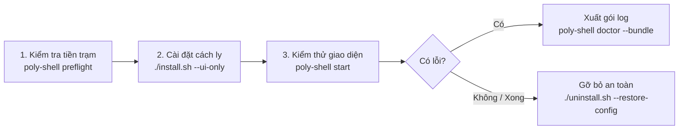

# ALPORA Tester & Quality Control Guide

Cẩm nang dành cho tester và người thử nghiệm **ALPORA (`poly-shell`)** trên Arch Linux và các bản phân phối dẫn xuất (EndeavourOS, CachyOS, Manjaro, Garuda...).

---

## 1. Quy trình Kiểm thử Nhanh (Quick Start)



---

## 2. Bước 1: Kiểm tra Điều kiện Môi trường (Pre-flight Inspection)

Trước khi tiến hành bất kỳ thao tác cài đặt nào, hãy chạy công cụ kiểm tra tiền trạm:

```bash
python3 -m poly_shell.cli preflight
```
*(hoặc nếu đã link binary: `poly-shell preflight`)*

**Kết quả kiểm tra bao gồm:**
* **Bản phân phối & Kernel:** Kiểm tra tính tương thích với pacman / Arch base.
* **Hyprland Wayland:** Xác định phiên bản Hyprland và số lượng màn hình đang kết nối.
* **Các gói cốt lõi (Core):** `quickshell`, `python3`, `hyprland`, `systemd`, `gdbus`.
* **Quyền ghi thư mục XDG:** Đảm bảo `~/.config`, `~/.local/state`, `XDG_RUNTIME_DIR` có quyền ghi.

> [!TIP]
> Bạn có thể xuất kết quả dạng JSON để gửi kèm theo báo cáo bằng lệnh: `poly-shell preflight --json`.

---

## 3. Bước 2: Cài đặt Thử nghiệm An toàn (Isolated Testing)

Để không làm ảnh hưởng đến cấu hình Hyprland hoặc Waybar cá nhân của bạn, ALPORA hỗ trợ các chế độ thử nghiệm cách ly:

### Cách A: Cài đặt chỉ riêng UI Shell (Đề xuất cho máy đang dùng)
```bash
./install.sh --ui-only
```
* **Ưu điểm:** Chỉ tạo symlink cho Quickshell và cài đặt service `poly-shell`. **Hoàn toàn không ghi đè** hay chỉnh sửa file cấu hình `hyprland.conf` / `hyprland.lua` sẵn có của bạn.
* Để chạy thử:
  ```bash
  poly-shell start
  ```
  *(Để tắt: `poly-shell stop`)*.

### Cách B: Chạy thử trong cửa sổ lồng (Nested Hyprland)
Nếu bạn muốn thử toàn bộ session mà không muốn đăng xuất khỏi desktop hiện tại:
```bash
Hyprland
```
Trong cửa sổ Hyprland mới mở, khởi chạy `poly-shell run`.

### Cách C: Cài đặt Đầy đủ (Full Managed Session)
```bash
./install.sh --theme=alpine-dawn --replace-config
```
* Installer sẽ tự động sao lưu toàn bộ cấu hình hiện tại của bạn vào `~/.local/state/poly-shell/backups/<timestamp>/` trước khi áp dụng.

---

## 4. Bước 3: Thu thập Báo cáo Sự cố (1-Click Diagnostics)

Nếu gặp bất kỳ hiện tượng lạ (thanh bar không hiện, biểu tượng pin/wifi báo sai, widget bị giật):
**Không cần copy log thủ công**, chỉ cần chạy lệnh:

```bash
poly-shell doctor --bundle
```

* Hệ thống sẽ tạo một tệp nén tại thư mục hiện tại: `alpora-diag-<YYYYMMDD-HHMMSS>.tar.gz`.
* Tệp này chứa:
  * Trạng thái phiên bản các gói phần mềm.
  * Cấu hình hiển thị màn hình và tỉ lệ scale.
  * Log 120 dòng gần nhất của `poly-shell.service` và `poly-shell-settings.service`.
  * Cấu hình session đã được **khử toàn bộ mật khẩu, token cá nhân**.
* Gửi tệp `.tar.gz` này cho nhóm phát triển để được xử lý nhanh nhất.

---

## 5. Bước 4: Khôi phục và Gỡ bỏ Sạch sẽ (Rollback & Uninstall)

Khi hoàn tất quá trình thử nghiệm, bạn có thể hoàn nguyên toàn bộ hệ thống:

```bash
./uninstall.sh --restore-config
```
* Lệnh trên sẽ tự động:
  * Tắt và vô hiệu hóa `poly-shell.service`.
  * Xóa các symlink tại `~/.local/bin/` và `~/.config/quickshell/`.
  * Khôi phục lại bản sao lưu cấu hình Hyprland / Waybar trước khi cài đặt.

Nếu muốn xóa toàn bộ dữ liệu tạm và cache:
```bash
./uninstall.sh --purge
```

---

## 6. Xử lý Sự cố Thường gặp (FAQ)

| Hiện tượng | Nguyên nhân khả dĩ | Cách xử lý |
| --- | --- | --- |
| **Thanh bar hoặc QuickSettings bị lỗi font chữ / icon** | Thiếu font Noto Sans hoặc biểu tượng SVG | Cài gói: `sudo pacman -S noto-fonts noto-fonts-cjk ttf-nerd-fonts-symbols` |
| **Không có thanh trượt độ sáng màn hình** | Đang dùng máy tính để bàn (PC) hoặc thiếu `brightnessctl` | Đây là tính năng tự suy thoái mềm: máy bàn không có cổng backlight sẽ tự ẩn thanh độ sáng |
| **Widget phát nhạc không nhận bài hát** | Trình phát chưa hỗ trợ giao thức MPRIS | Đảm bảo trình phát (Spotify, Chromium, Firefox, MPV) đã bật cờ MPRIS |
| **Quickshell báo lỗi version mismatch** | Phiên bản Qt và Quickshell bị lệch | Chạy `pacman -Q quickshell qt6-base` để kiểm tra phiên bản khớp nhau |

---

## 7. Các bước Bàn giao & Tối ưu Vận hành Thực tế (Production Handover Checklist)

Sau khi cài đặt hoặc cập nhật phiên bản mới, thực hiện 3 bước sau để đưa ALPORA vào trạng thái Daily Driver ổn định nhất:

### 1. Khởi chạy và Giám sát Daemon tự động (Systemd User Service)
Đảm bảo daemon ALPORA được quản lý bởi systemd với cơ chế `Restart=always` (tự khởi động lại trong 1 giây nếu gặp sự cố):
```bash
systemctl --user daemon-reload
systemctl --user enable --now poly-shell.service
```
Kiểm tra trạng thái đang hoạt động:
```bash
systemctl --user status poly-shell.service
```

### 2. Cấu hình Phím tắt Khẩn cấp / Cứu hộ (Safe Mode Fallback)
Khai báo một phím tắt độc lập trong `~/.config/hypr/hyprland.conf` để luôn luôn có thể mở ngay một Terminal độc lập cứu hộ khi cần debug mà không phụ thuộc vào UI panel:
```ini
# ALPORA Emergency Terminal Fallback (Always accessible)
bind = SUPER SHIFT, Return, exec, kitty || foot
```

### 3. Thiết lập Alias Chẩn đoán Nhanh (1-Command Healthcheck)
Thêm alias chẩn đoán vào shell profile (`~/.bashrc` hoặc `~/.zshrc`):
```bash
echo 'alias alpora-doctor="poly-shell doctor"' >> ~/.bashrc
# hoặc nếu dùng zsh:
echo 'alias alpora-doctor="poly-shell doctor"' >> ~/.zshrc
```
Bất cứ khi nào cài thêm phần mềm mới hoặc nghi ngờ có xung đột, chỉ cần gõ:
```bash
alpora-doctor
```
Hệ thống sẽ quét toàn bộ danh sách công cụ, quyền thư mục và dịch vụ nền trong chưa đầy 1 giây.

